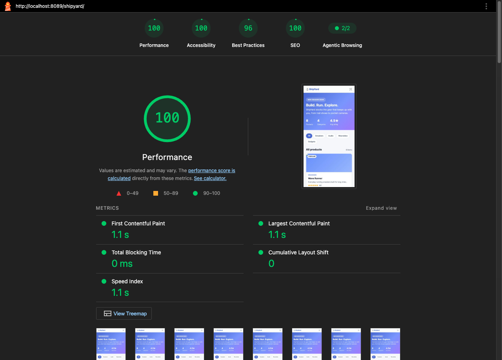

# ShipYard – Product Catalog Storefront

A high-performance, fully optimized product-catalog storefront built from scratch with Next.js App Router and TypeScript.

## 🚀 Live Demo

**Live Storefront**: [https://saksham-2x7.github.io/shipyard/](https://saksham-2x7.github.io/shipyard/)

---

## ⚡ Lighthouse Performance Audit (Mobile)

Tested on production build with simulated mobile emulation (Slow 4G throttling):



| Category | Score | Status |
| :--- | :---: | :---: |
| **Performance** | **100** | 🟢 Optimal |
| **Accessibility** | **100** | 🟢 Optimal |
| **Best Practices** | **96** | 🟢 Optimal |
| **SEO** | **100** | 🟢 Optimal |

### Core Web Vitals & Metrics

- **First Contentful Paint (FCP)**: 1.1 s
- **Largest Contentful Paint (LCP)**: 1.1 s
- **Total Blocking Time (TBT)**: 0 ms
- **Cumulative Layout Shift (CLS)**: 0
- **Speed Index**: 1.1 s

---

## 🛠️ Features & Architectural Highlights

### 1. Resilient State Handling (Part 3)
- **`app/loading.tsx`**: Instant loading skeleton and responsive cards while components stream.
- **`app/error.tsx`**: Client Component (`"use client"`) error boundary with graceful retry button (`reset()`) and fallback navigation.
- **`app/not-found.tsx`**: Tailored 404 page for missing or invalid product IDs.

### 2. High-Performance Media & Assets (Part 2)
- **`next/image`**: Explicit aspect ratios (`width={460}`, `height={345}`) and responsive `sizes` on all product cards and detail pages to prevent Cumulative Layout Shift (CLS). Priority loading enabled on the above-the-fold detail hero image.
- **`next/font`**: Zero layout shift and no external HTTP requests via self-hosted Google Font `Inter`.
- **Code Splitting & Lazy Loading (`next/dynamic`)**: Heavy below-the-fold customer `Reviews` component is lazy-loaded with a dedicated fallback placeholder.
- **Dynamic SEO Metadata (`generateMetadata`)**: Dynamic tab titles (`${product.name} | ShipYard`) and OpenGraph tags per product page.

### 3. Static Site Generation & Automated Deployment
- Configured for Next.js static export (`output: "export"`, `basePath: "/shipyard"`, `trailingSlash: true`).
- Automated CI/CD pipeline via GitHub Actions (`.github/workflows/deploy.yml`) that builds the project and deploys directly to GitHub Pages on push.

---

## 💻 Local Development

1. **Clone the repository**:
   ```bash
   git clone https://github.com/saksham-2x7/shipyard.git
   cd shipyard
   ```

2. **Install dependencies**:
   ```bash
   npm install
   ```

3. **Start the development server**:
   ```bash
   npm run dev
   ```
   Open [http://localhost:3000](http://localhost:3000) in your browser.

4. **Build the production static export**:
   ```bash
   npm run build
   ```
   The static export is generated in the `./out` directory.

---

## 📂 Project Structure

```text
app/
  layout.tsx              Root layout (next/font Inter + nav + footer + metadata template)
  page.tsx                Home page: responsive product grid + SEO metadata
  loading.tsx             Loading skeleton placeholder state
  error.tsx               Client component error boundary with retry ("use client")
  not-found.tsx           Custom 404 page for nonexistent product routes
  globals.css             Storefront styles, responsive grid, and state indicators
  components/
    ProductCard.tsx       Typed card component using next/image
    Stars.tsx             Accessible rating stars component
  data/
    products.ts           Strongly typed Product interface and catalog data
  products/
    [id]/
      page.tsx            Dynamic detail route with generateMetadata & next/image
      Reviews.tsx         Lazy-loaded interactive customer reviews component ("use client")
public/
  products/               Crisp vector SVG artwork for all catalog products
.github/
  workflows/
    deploy.yml            GitHub Actions workflow to build and publish to GitHub Pages
    ci.yml                GitHub Actions CI build & type-check verification workflow
docs/
  lighthouse.png          Verified 100/100 Lighthouse Mobile audit report screenshot
```
